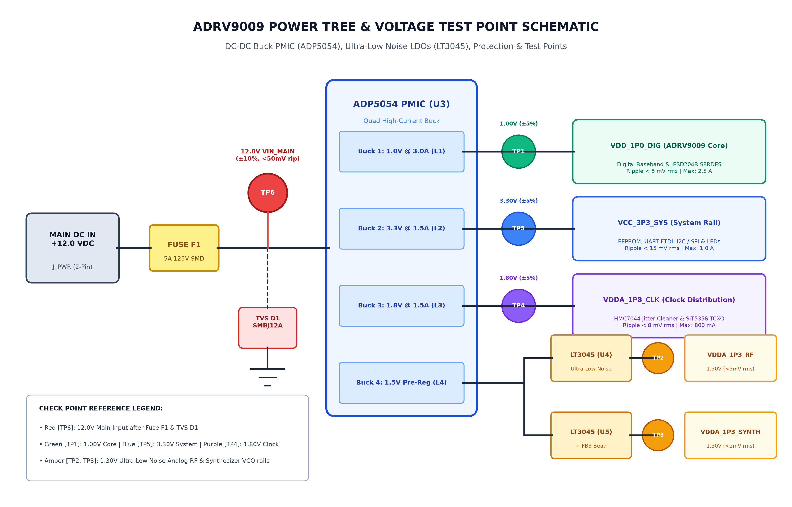
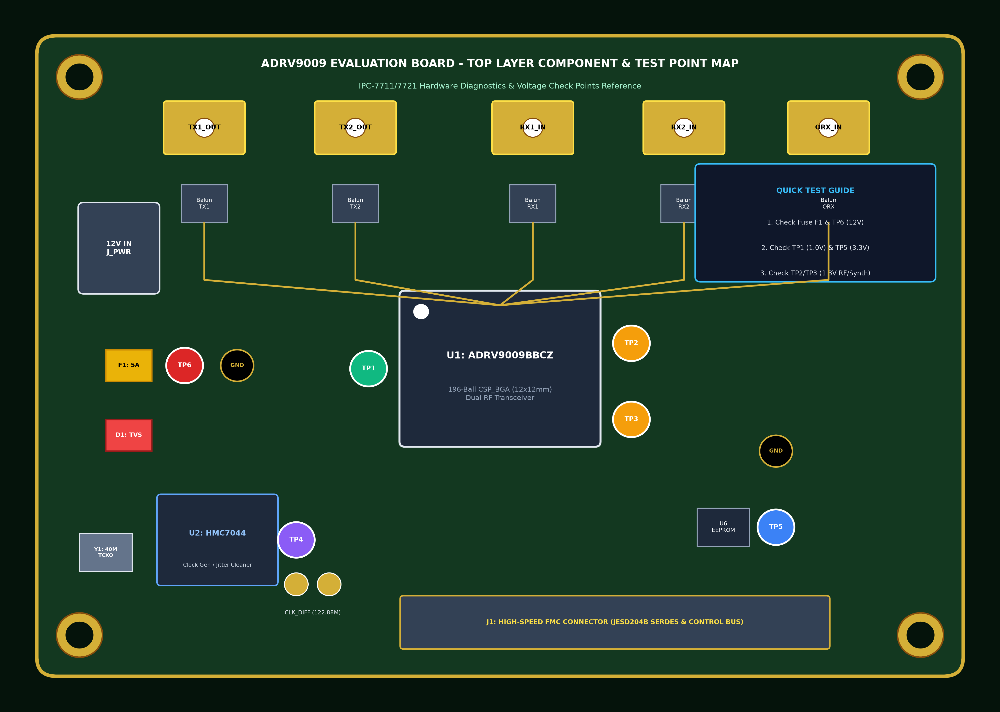
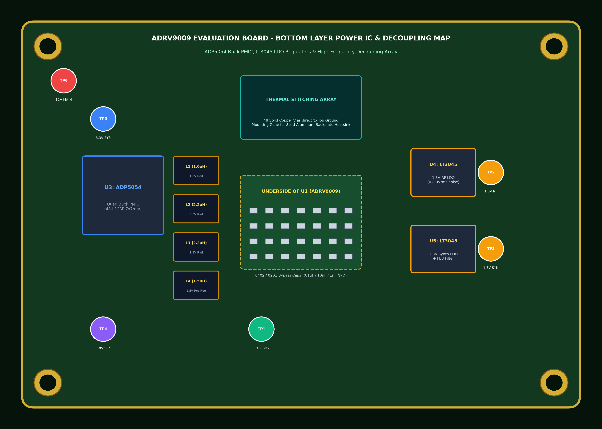

# ADRV9009 RF Transceiver Board Hardware Maintenance, Troubleshooting & Repair Manual
## دستورالعمل جامع نگهداری پیشگیرانه، عیب‌یابی و تعمیرات سخت‌افزاری برد فرستنده/گیرنده ADRV9009

---

### Document Overview & Metadata / مشخصات و شناسنامه سند
- **Hardware Under Maintenance:** ADRV9009 Dual-Channel Wideband RF Transceiver Evaluation & Baseband Carrier Board
- **Maintenance Standards:** IPC-7711/7721 (Rework & Repair of Electronic Assemblies), IPC-A-610 Class 3
- **Document Version:** v1.0.0 — October 2026 | Technical Maintenance Manual for eLynxSDR System Engineers

---

# Part 1: English Hardware Maintenance & Repair Procedures

## 1. Preventative Maintenance Schedules & Visual Inspection Standards

| Inspection Interval | Target Subsystem / Component | Action Required & Standard | Tools / Materials |
| :--- | :--- | :--- | :--- |
| **Daily / Pre-Operation** | RF SMA Connectors (TX1, TX2, RX1, RX2, ORX) | Inspect center pin integrity, verify no debris or stripped threads. Torque to 8 in-lbs (0.9 N·m). | 5/16-inch SMA Torque Wrench, Lint-free swabs |
| **Monthly** | Cooling Fan & Heatsink Fins | Inspect dust buildup, verify tachometer RPM (> 4500 RPM), clear airflow channels. | Dry compressed air (< 30 psi), Soft brush |
| **Quarterly (3 Months)**| Power Supply Rails & Ripple | Probe test points TP1–TP6; verify AC ripple < 5 mV rms on 1.0V and 1.3V rails. | 6.5-digit Multimeter, 1 GHz Oscilloscope |
| **Semi-Annually (6 Mo)**| Thermal Interface Material (TIM) | Inspect thermal pad elasticity. Replace dried thermal paste (PTM7950 phase change material). | 99.9% Isopropyl Alcohol (IPA), TIM pad kit |
| **Annually** | Solder Joints & BGA Underfill | 20x stereo microscope inspection for solder oxidation, tin whiskers, and conformal coating voids. | Stereo Microscope, UV Inspection Lamp |

> **CRITICAL ESD PROTECTION WARNING:**  
> The ADRV9009 IC contains ultra-sensitive RF GaAs/CMOS structures sensitive to ESD pulses < 250V (HBM Class 1A). Always wear a grounded wrist strap (1 MΩ series resistor) and work on an ESD-dissipative mat.

---

## 2. DC Power Supply Rail Diagnostics & Test Point Mapping

| Test Point | Power Rail Name | Nominal Voltage | Tolerance | Max AC Ripple | Failure Symptoms & Root Cause |
| :---: | :--- | :---: | :---: | :---: | :--- |
| **TP1** | `VDD_1P0_DIG` | 1.00 V | $\pm 5\%$ (0.95 – 1.05 V) | $< 5\text{ mV rms}$ | JESD204B link down, digital core unbootable. Check ADP5054 Buck 1 / LDO. |
| **TP2** | `VDDA_1P3_RF` | 1.30 V | $\pm 5\%$ (1.24 – 1.36 V) | $< 3\text{ mV rms}$ | Elevated phase noise, LO unlock, mixer distortion. Check LT3045 LDO regulator. |
| **TP3** | `VDDA_1P3_SYNTH` | 1.30 V | $\pm 5\%$ (1.24 – 1.36 V) | $< 2\text{ mV rms}$ | RFPLL fails to lock, carrier frequency drift. Check ferrite bead FB3 filtering. |
| **TP4** | `VDDA_1P8_CLK` | 1.80 V | $\pm 5\%$ (1.71 – 1.89 V) | $< 8\text{ mV rms}$ | HMC7044 clock jitter excessive, missing SYSREF. Check Buck 3 inductor L4. |
| **TP5** | `VCC_3P3_SYS` | 3.30 V | $\pm 5\%$ (3.14 – 3.46 V) | $< 15\text{ mV rms}$| I2C/SPI bus failure, EEPROM unreadable, UART disconnected. Check main 3.3V DC-DC. |
| **TP6** | `VIN_12V0_MAIN` | 12.00 V | $\pm 10\%$ (10.8 – 13.2 V) | $< 50\text{ mV rms}$| Complete board blackout. Check input fuse F1 (5A Fast-blow) & TVS diode D1. |

### Figure 1.1: Power Tree & Voltage Test Points Architecture Schematic

*Figure 1.1: ADRV9009 Power Tree Architecture & Voltage Check Points Schematic (ADP5054 PMIC, LT3045 LDOs, Fuse F1, and TP1–TP6).*

### Figure 1.2: PCB Top Layer Component & Check Point Map

*Figure 1.2: ADRV9009 Evaluation Board Top Layer Layout & Voltage Test Point Locations (Fuse F1, TVS D1, U1 ADRV9009, U2 HMC7044, Baluns T1–T4, and Check Points TP1–TP6).*

### Figure 1.3: PCB Bottom Layer Power ICs & Decoupling Map

*Figure 1.3: ADRV9009 Evaluation Board Bottom Layer Component & Decoupling Map (ADP5054 PMIC U3, LT3045 LDOs U4/U5, Inductors L1–L4, and High-Frequency BGA Decoupling Array).*

---

## 3. Clock Distribution (HMC7044) & PLL Lock Diagnostics
1. **Query HMC7044 Lock Status via Sysfs:**
   ```bash
   cat /sys/bus/iio/devices/iio:device*/name | grep hmc7044
   iio_attr -d hmc7044 pll1_locked
   iio_attr -d hmc7044 pll2_locked
   ```
2. **DEV_CLK Probing:** Probe differential test points `TP_CLK_P` / `TP_CLK_N` with a differential probe. Nominal: 122.88 MHz LVDS, 700 mVpp.
3. **TCXO Reference Inspection:** Verify the 40.000 MHz Stratum 3 oscillator (SiT5356) output on pin 3. Frequency drift must be within $\pm 0.1\text{ ppm}$.

---

## 4. ADRV9009 BGA IC Rework & Reflow Soldering Profile
The ADRV9009 is housed in a **196-ball CSP_BGA ($12\text{ mm} \times 12\text{ mm}$, 0.8 mm ball pitch)**.
- **PCB Baking:** 8 hours at $125^\circ\text{C}$ prior to rework to prevent moisture-induced delamination (popcorning).
- **Preheat Zone:** Ramp at $+1.5^\circ\text{C/s}$ from $150^\circ\text{C}$ to $170^\circ\text{C}$ (80–100s).
- **Soak / Flux Activation:** $170^\circ\text{C}$ to $200^\circ\text{C}$ for 60–90s.
- **Liquidus Transition:** $217^\circ\text{C}$ (SAC305 lead-free alloy).
- **Peak Reflow:** $235^\circ\text{C}$ to $245^\circ\text{C}$ (Time Above Liquidus: 40–60s).
- **Cooling Rate:** $-2.5^\circ\text{C/s}$ to $-3.0^\circ\text{C/s}$ down to room temperature.
- **X-Ray Inspection:** Solder voiding must not exceed 15% per ball; zero solder bridges.

### Figure 1.4: BGA Rework Thermal Profile

*Figure 1.4: ADRV9009 196-Ball CSP_BGA Rework & Soldering Thermal Profile (IPC-7711/7721 Standard SAC305 Lead-Free Alloy).*

---

## 5. Bill of Materials (BOM) for Critical Spare Parts

| Designator | Part Number | Manufacturer | Package / Footprint | Function |
| :---: | :--- | :--- | :--- | :--- |
| **U1** | `ADRV9009BBCZ` | Analog Devices | 196-Ball CSP_BGA ($12 \times 12\text{ mm}$) | Dual RF Transceiver Core IC |
| **U2** | `HMC7044LP10BE` | Analog Devices | 64-Lead LFCSP ($9 \times 9\text{ mm}$) | Clock Jitter Cleaner & Generator |
| **U3** | `ADP5054ACPZ-R7` | Analog Devices | 48-Lead LFCSP ($7 \times 7\text{ mm}$) | Quad High-Current Buck PMIC |
| **U4, U5**| `LT3045EDD#PBF` | Analog Devices | 10-Lead DFN ($3 \times 3\text{ mm}$) | Ultra-Low Noise ($0.8\,\mu\text{V}_{\text{rms}}$) RF LDO |
| **T1–T4** | `TCM1-63AX+` | Mini-Circuits | 6-SMD ($3.8 \times 3.8\text{ mm}$) | $50\,\Omega : 100\,\Omega$ RF Balun (10–6000 MHz) |
| **D1–D4** | `PESD5V0U1BL` | Nexperia | SOD-882 ($1.0 \times 0.6\text{ mm}$) | 0.5 pF Low-Capacitance RF ESD Protection |
| **Y1** | `SiT5356AI-FP-33E`| SiTime | SMD 5032 ($5.0 \times 3.2\text{ mm}$) | 40.000 MHz Stratum 3 Precision TCXO |

---

## 6. End-to-End Hardware System Troubleshooting Flowchart

### Figure 1.5: Hardware Troubleshooting & Fault Isolation Flowchart

*Figure 1.5: End-to-End ADRV9009 Hardware System Troubleshooting & Fault Isolation Flowchart.*

---

# Part 2: Persian Hardware Maintenance Guide (بخش فارسی)

## ۱. زمان‌بندی نگهداری پیشگیرانه و استانداردهای بازرسی چشمی

| دوره بازرسی | زیرسیستم هدف | اقدام و استاندارد بازرسی | ابزارها و مواد مصرفی |
| :--- | :--- | :--- | :--- |
| **روزانه** | کانکتورهای SMA | بررسی سلامت پین مرکزی و رزوه‌ها؛ سفت‌کردن با گشتاور استاندارد 0.9 N·m. | آچار ترکمتر SMA (5/16 اینچ) |
| **ماهانه** | هیت‌سینک و فن | غبارزدایی پره‌ها؛ کنترل دور فن خنک‌کننده (> 4500 RPM). | دمنده هوای خشک (< 30 psi) |
| **سه ماهه** | خطوط تغذیه DC | اندازه‌گیری ولتاژ نقاط تست TP1-TP6؛ کنترل ریپل به کمتر از 5 mV. | مولتی‌متر دیجیتال، اسیلوسکوپ |
| **شش ماهه** | پد سیلیکونی | بررسی انعطاف‌پذیری پد حرارتی؛ تعویض خمیر سیلیکون فرسوده (PTM7950). | الکل ایزوپروپیل ۹۹.۹٪ (IPA) |
| **سالانه** | اتصالات BGA | بازرسی میکروسکوپی ترک‌های قلع، ویسکرها و تست رطوبت‌زدایی. | میکروسکوپ استریو ۲۰ برابر |

---

## ۲. عیب‌یابی خطوط تغذیه DC، شماتیک نقاط تست و نقشه‌های PCB

| نقطه تست | نام خط تغذیه | ولتاژ نامی | تلرانس مجاز | حداکثر ریپل | علائم خرابی و ریشه عیب |
| :---: | :--- | :---: | :---: | :---: | :--- |
| **TP1** | هسته دیجیتال (1.0V) | 1.00 V | $\pm 5\%$ | $< 5\text{ mV}$ | قطع لینک JESD204B؛ بررسی مبدل Buck آی‌سی ADP5054. |
| **TP2** | آنالوگ RF (1.3V) | 1.30 V | $\pm 5\%$ | $< 3\text{ mV}$ | نویز فاز شدید و افت گین میکسر؛ بررسی رگولاتور LT3045. |
| **TP3** | سینتی‌سایزر (1.3V) | 1.30 V | $\pm 5\%$ | $< 2\text{ mV}$ | قفل نشدن RFPLL نوسان‌ساز؛ بررسی فیلتر فریت FB3. |
| **TP4** | کلاک (1.8V) | 1.80 V | $\pm 5\%$ | $< 8\text{ mV}$ | جیتر شدید کلاک HMC7044؛ بررسی سلف سوئیچینگ L4. |
| **TP5** | ولتاژ سیستم (3.3V) | 3.30 V | $\pm 5\%$ | $< 15\text{ mV}$| عدم شناسایی پورت سریال و EEPROM؛ بررسی مبدل DCDC. |
| **TP6** | ورودی برد (12.0V) | 12.00 V | $\pm 10\%$ | $< 50\text{ mV}$| خاموشی کامل برد؛ بررسی فیوز ورودی F1 (5A) و دیود TVS. |

### شکل ۲.۱: شماتیک مدار توزیع توان و نقاط تست ولتاژ

*شکل ۲.۱: شماتیک معماری مدار توزیع توان (Power Tree) و نقاط تست ولتاژ برد ADRV9009 شامل فیوز F1، رگولاتورهای ADP5054 و LT3045 و نقاط TP1 تا TP6.*

### شکل ۲.۲: نقشه لایه روی برد (PCB Top Layer)

*شکل ۲.۲: نقشه لایه روی برد (PCB Top Layer) و جانمایی فیوز ورودی F1، دیود محافظ TVS، تراشه‌های ADRV9009 و HMC7044، بالون‌ها و نقاط تست ولتاژ TP1 تا TP6.*

### شکل ۲.۳: نقشه لایه پشت برد (PCB Bottom Layer)

*شکل ۲.۳: نقشه لایه پشت برد (PCB Bottom Layer) و موقعیت آی‌سی مدیریت توان ADP5054، رگولاتورهای فوق‌کم‌نویز LT3045، سلف‌های قدرت و ماتریس خازن‌های دیکوپلینگ BGA.*

---

## ۳. دستورالعمل ریورک و تعویض تراشه BGA فرستنده/گیرنده ADRV9009
تراشه **ADRV9009** در پکیج BGA با **۱۹۶ توپ قلع** (ابعاد $12\text{ mm} \times 12\text{ mm}$ با گام 0.8 میلی‌متر) قرار دارد.
1. **رطوبت‌زدایی (Baking):** برد پیش از ریورک به مدت ۸ ساعت در دمای ۱۲۵ درجه سانتی‌گراد در کوره رطوبت‌زدایی قرار گیرد تا از تاول‌زدگی (Popcorning) جلوگیری شود.
2. **پروفایل حرارتی ریفلو:**
   - پیش‌گرمایش تدریجی با نرخ $+1.5^\circ\text{C/s}$ تا دمای ۱۷۰ درجه سانتی‌گراد.
   - ناحیه تثبیت فلاکس (Soak) از ۱۷۰ تا ۲۰۰ درجه به مدت ۶۰ تا ۹۰ ثانیه.
   - اوج حرارت مایع‌شدن قلع SAC305 در دمای **۲۳۵ تا ۲۴۵ درجه سانتی‌گراد** به مدت ۴۵ ثانیه.
   - خنک‌کاری کنترل‌شده با نرخ $-2.5^\circ\text{C/s}$ جهت تشکیل پیوند متالورژیکی مرغوب.
3. **تراز نوری با منشور اسپلیت‌ویژن** و کنترل کیفیت اتصالات با **تصویربرداری اشعه ایکس (X-Ray)** جهت تایید عدم وجود پل قلع و حباب هوای کمتر از ۱۵ درصد.

### شکل ۲.۴: پروفایل حرارتی استاندارد ۴ مرحله‌ای ریورک BGA

*شکل ۲.۴: پروفایل حرارتی استاندارد ۴ مرحله‌ای ریورک و لحیم‌کاری هوای گرم BGA بر اساس استاندارد IPC-7711/7721 با آلیاژ SAC305.*

---

## ۴. فلوچارت جامع عیب‌یابی و تفکیک خطای سخت‌افزاری برد

### شکل ۲.۵: فلوچارت گام‌به‌گام عیب‌یابی و تعمیرات سخت‌افزاری

*شکل ۲.۵: فلوچارت گام‌به‌گام عیب‌یابی، تست خطوط تغذیه، پایش سلامت کلاک و تفکیک خطاهای سخت‌افزاری برد فرستنده/گیرنده ADRV9009.*
