# ADRV9009 RF Transceiver Board Hardware Maintenance, Troubleshooting & Repair Manual
## دستورالعمل جامع نگهداری پیشگیرانه، عیب‌یابی و تعمیرات سخت‌افزاری برد فرستنده/گیرنده ADRV9009

---

### Document Overview & Metadata / مشخصات و شناسنامه سند
- **Hardware Under Repair:** ADRV9009 Dual-Channel Wideband RF Transceiver Evaluation & Baseband Carrier Board
- **Maintenance Level:** Level 1 (Field Maintenance), Level 2 (Bench Testing), Level 3 (BGA Component Repair)
- **Workmanship Standards:** IPC-7711/7721 (Rework & Repair of Electronic Assemblies), IPC-A-610 Class 3
- **Document Version:** v2.3.0 — October 2026 | Technical Maintenance Manual for eLynxSDR System Engineers

---

# Part 1: English Hardware Maintenance & Repair Procedures

## 1. Preventative Maintenance Schedules & Visual Inspection Standards

| Inspection Interval | Target Subsystem / Component | Action Required & Standard | Tools / Materials |
| :--- | :--- | :--- | :--- |
| **Daily / Pre-Operation** | RF SMA Connectors (TX1, TX2, RX1, RX2, ORX) | Inspect center pin integrity, verify no debris or stripped threads. Torque to 8 in-lbs (0.9 N·m). | 5/16-inch SMA Torque Wrench, Lint-free swabs |
| **Monthly** | Cooling Fan & Heatsink Fins | Inspect dust buildup, verify tachometer RPM (> 4500 RPM), clear airflow channels. | Dry compressed air (< 30 psi), Soft brush |
| **Quarterly (3 Months)**| Power Supply Rails & Ripple | Probe test points TP1–TP6; verify AC ripple < 5 mV rms on 1.0V and 1.3V rails. | 6.5-digit Multimeter, 1 GHz Oscilloscope |
| **Semi-Annually (6 Mo)**| Thermal Interface Material (TIM) | Inspect thermal pad elasticity. Replace dried thermal paste (PTM7950 phase change material). | 99.9% Isopropyl Alcohol (IPA), TIM pad kit |
| **Annually** | Solder Joints & BGA Underfill | 20x stereo microscope inspection for solder oxidation, tin whiskers, and conformal coating voids. | Stereo Microscope, UV Inspection Lamp |

> **CRITICAL ESD PROTECTION WARNING:**  
> The ADRV9009 IC contains ultra-sensitive RF GaAs/CMOS structures sensitive to ESD pulses < 250V (HBM Class 1A). Always wear a grounded wrist strap (1 MΩ series resistor) and work on an ESD-dissipative mat.

---

## 2. Altium Designer Job 1 Output: Complete Schematic Prints (Sheets 1 to 6) & Fault Tracing Reference

### Figure 1.0: Altium Job 1 Multi-Sheet Schematic Compilation Overview (Job1.PDF)
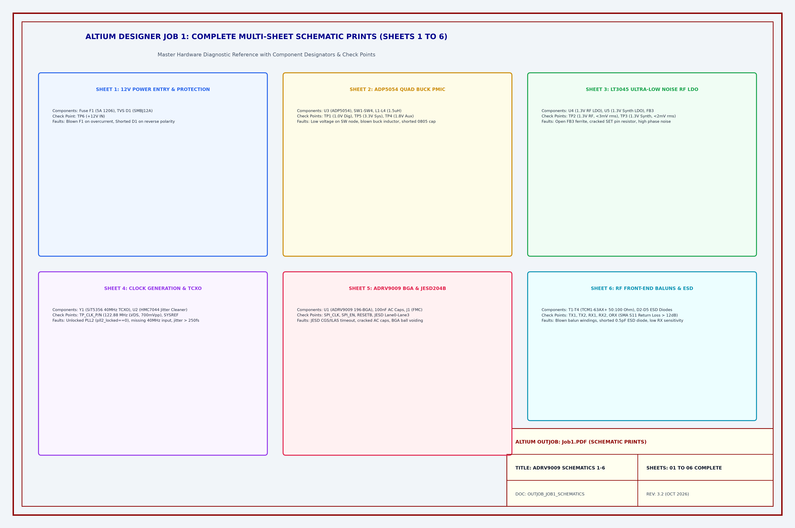
*Figure 1.0: Altium Designer OutJob 'Job1.PDF' — Complete Multi-Sheet Schematic Prints (Sheets 1 to 6) Compilation Overview & Subsystem Diagnostic Reference.*

---

### 2.1 Schematic Sheet 1: 12V Main Power Entry, Fuse F1 & TVS D1 Protection
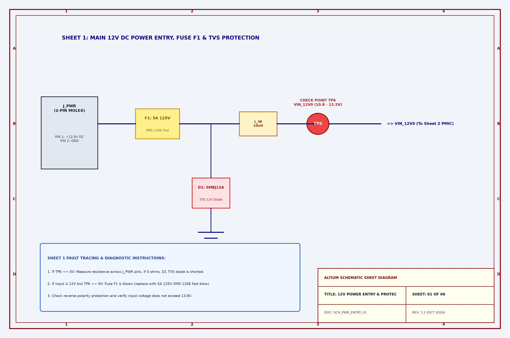
*Figure 1.1: Schematic Sheet 1 — 12V Main DC Power Entry, Fuse F1 (5A), TVS Diode D1, and Check Point TP6.*
- **Check Points:** Probe TP6 vs. GND (10.8V to 13.2V).
- **Fault Tracing:** If TP6 == 0V, measure resistance across J_PWR pins. If 0Ω, TVS diode D1 is shorted. If input is 12V but TP6 == 0V, Fuse F1 is blown (replace with 5A 125V SMD 1206 fast-blow).

---

### 2.2 Schematic Sheet 2: ADP5054 Quad Buck PMIC & Inductors L1–L4
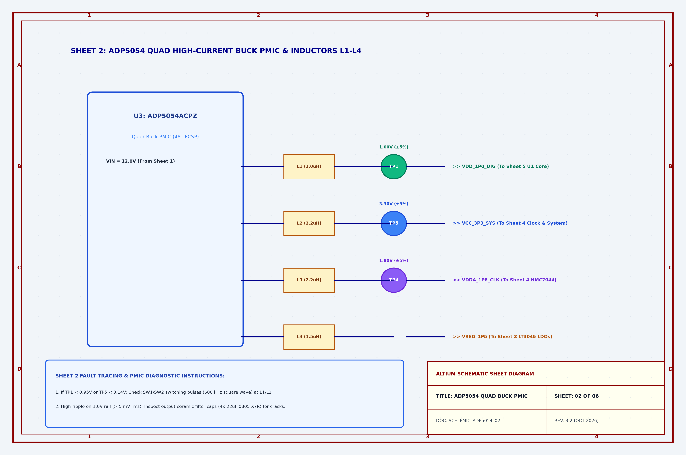
*Figure 1.2: Schematic Sheet 2 — ADP5054 Quad Buck PMIC (U3), Inductors L1–L4, and Check Points TP1 (1.0V), TP5 (3.3V), TP4 (1.8V).*
- **Check Points:** TP1 (1.00V ±5%), TP5 (3.30V ±5%), TP4 (1.80V ±5%).
- **Fault Tracing:** If TP1 < 0.95V, check SW1 switching node on inductor L1 with oscilloscope (600 kHz square wave). Check for cracked 0805 filter capacitors.

---

### 2.3 Schematic Sheet 3: LT3045 Ultra-Low Noise RF & Synthesizer LDOs
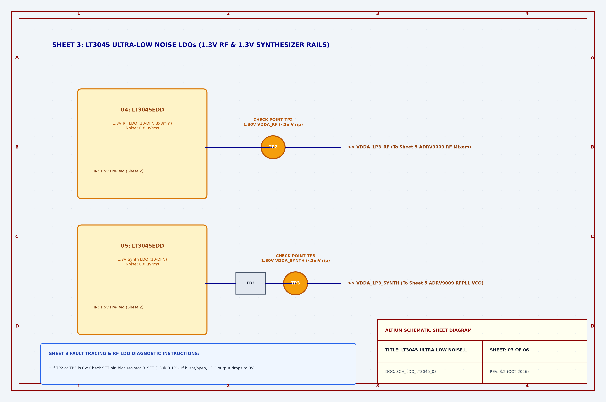
*Figure 1.3: Schematic Sheet 3 — LT3045 Ultra-Low Noise RF LDO (U4), Synth LDO (U5), FB3 Bead, and Check Points TP2 (1.3V RF) & TP3 (1.3V Synth).*
- **Check Points:** TP2 (1.30V ±5%, ripple < 3 mV rms), TP3 (1.30V ±5%, ripple < 2 mV rms).
- **Fault Tracing:** If TP2/TP3 is 0V, inspect SET pin bias resistor R_SET (130kΩ 0.1%). Inspect FB3 ferrite bead for open circuit.

---

### 2.4 Schematic Sheet 4: Clock Generation (HMC7044) & 40MHz TCXO
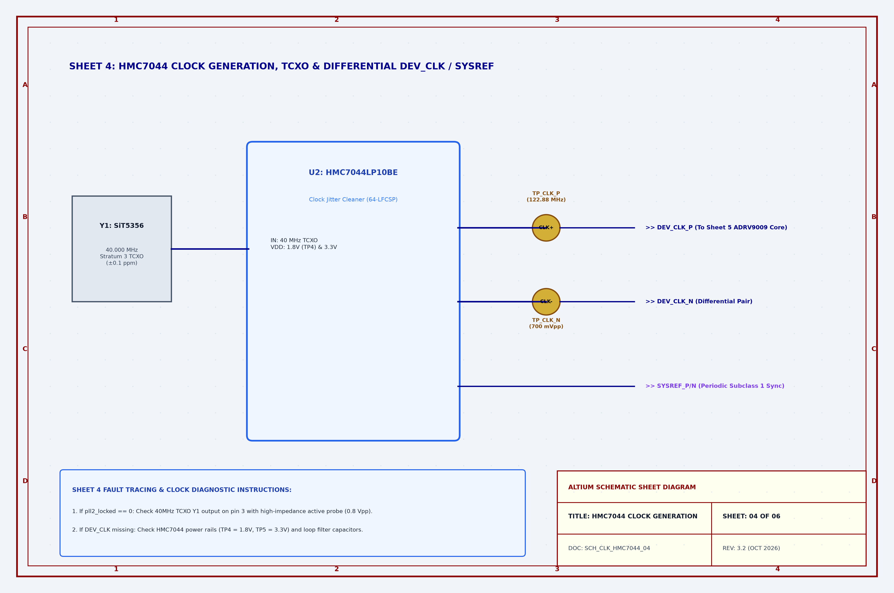
*Figure 1.4: Schematic Sheet 4 — SiT5356 40MHz TCXO (Y1), HMC7044 Clock Jitter Cleaner (U2), and Differential DEV_CLK (TP_CLK_P/N).*
- **Check Points:** Probe `TP_CLK_P` / `TP_CLK_N` (122.88 MHz differential LVDS, 700 mVpp).
- **Fault Tracing:** If `pll2_locked == 0`, verify SiT5356 TCXO 40 MHz output on pin 3. Check loop filter capacitors C112/C115.

---

### 2.5 Schematic Sheet 5: ADRV9009 Core (U1) & JESD204B High-Speed SERDES
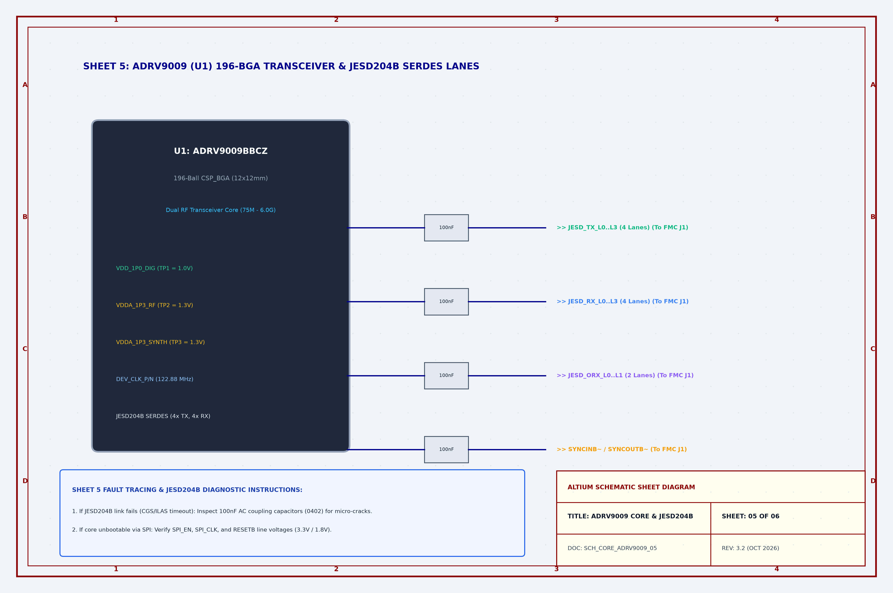
*Figure 1.5: Schematic Sheet 5 — ADRV9009 (U1) 196-BGA Core, 100nF AC Coupling Capacitors, and JESD204B Interface.*
- **Check Points:** Probe SPI_EN, SPI_CLK, RESETB lines.
- **Fault Tracing:** If JESD204B link fails (CGS/ILAS timeout), inspect 100nF 0402 AC coupling capacitors on SERDES differential pairs for micro-cracks.

---

### 2.6 Schematic Sheet 6: RF Front-End Matching Baluns (T1–T4) & ESD Protection
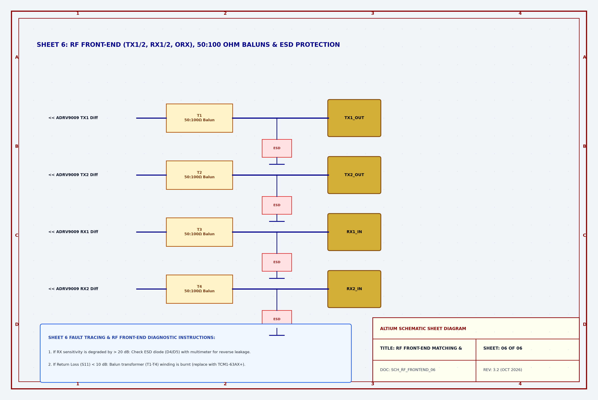
*Figure 1.6: Schematic Sheet 6 — Wideband RF Baluns T1–T4 (TCM1-63AX+), ESD Diodes D2–D5, and SMA Connectors.*
- **Check Points:** VNA S11 Return Loss > 12 dB across 75 MHz – 6 GHz.
- **Fault Tracing:** If RX sensitivity drops by > 20 dB, test ESD diode (D4/D5) for reverse leakage or short circuit. Replace burnt baluns (T1–T4).

---

## 3. Altium Designer Job 2 Output: PCB Assembly & Fabrication Prints (Job2.PDF) & Fault Maps

### Figure 1.7: Altium Job 2 PCB Assembly Overview (Top & Bottom Layers)
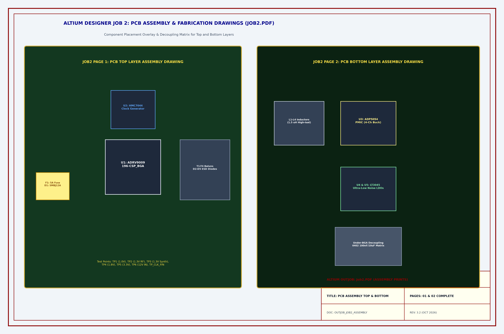
*Figure 1.7: Altium Designer OutJob 'Job2.PDF' — PCB Assembly & Fabrication Prints (Top & Bottom Layers Compilation Overview).*

### Figure 1.8: PCB Top Layer Component & Fault Tracing Map
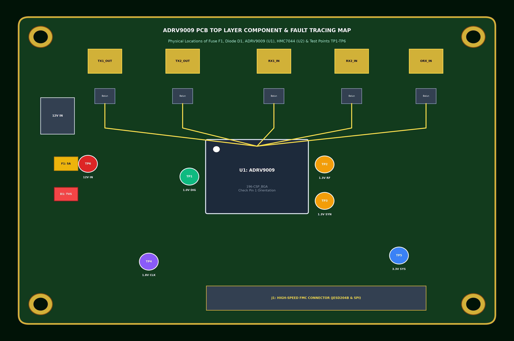
*Figure 1.8: ADRV9009 PCB Top Layer Component & Fault Tracing Map (Locations of Fuse F1, Diode D1, ADRV9009 U1, HMC7044 U2, Baluns T1–T4, and Test Points TP1–TP6).*

### Figure 1.9: PCB Bottom Layer Component & Decoupling Map
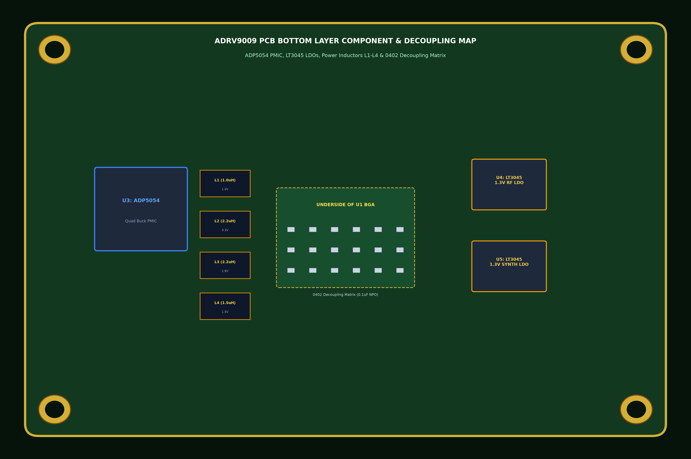
*Figure 1.9: ADRV9009 PCB Bottom Layer Component & Decoupling Map (ADP5054 PMIC U3, LT3045 LDOs U4/U5, Inductors L1–L4, and Underside BGA 0402 Decoupling Matrix).*

---

## 4. ADRV9009 BGA IC Rework & Reflow Soldering Profile (IPC-7711/7721)

### Figure 1.10: BGA Rework Thermal Profile
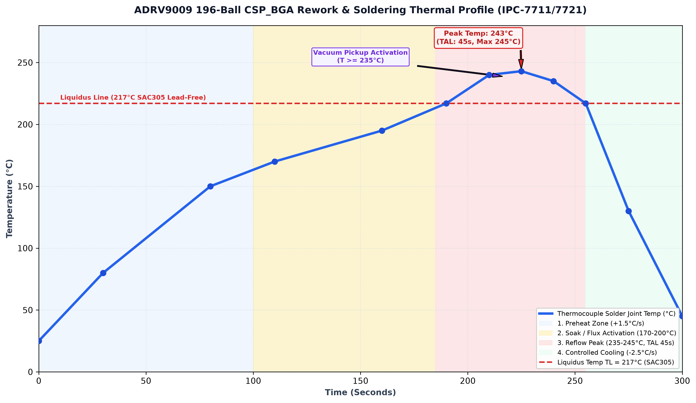
*Figure 1.10: ADRV9009 196-Ball CSP_BGA Rework & Soldering Thermal Profile (IPC-7711/7721 Standard SAC305 Lead-Free Alloy).*

---

## 5. Bill of Materials (BOM) for Critical Spare Parts

| Designator | Part Number | Manufacturer | Package / Footprint | Function |
| :---: | :--- | :--- | :--- | :--- |
| **U1** | `ADRV9009BBCZ` | Analog Devices | 196-Ball CSP_BGA ($12 \times 12\text{ mm}$) | Dual RF Transceiver Core IC |
| **U2** | `HMC7044LP10BE` | Analog Devices | 64-Lead LFCSP ($9 \times 9\text{ mm}$) | Clock Jitter Cleaner & Generator |
| **U3** | `ADP5054ACPZ-R7` | Analog Devices | 48-Lead LFCSP ($7 \times 7\text{ mm}$) | Quad High-Current Buck PMIC |
| **U4, U5**| `LT3045EDD#PBF` | Analog Devices | 10-Lead DFN ($3 \times 3\text{ mm}$) | Ultra-Low Noise ($0.8\,\mu\text{V}_{\text{rms}}$) RF LDO |
| **T1–T4** | `TCM1-63AX+` | Mini-Circuits | 6-SMD ($3.8 \times 3.8\text{ mm}$) | $50\,\Omega : 100\,\Omega$ RF Balun (10–6000 MHz) |
| **D1** | `SMBJ12A` | Littelfuse | DO-214AA (SMB) | 12V Unidirectional TVS Diode |
| **D2–D5** | `PESD5V0U1BL` | Nexperia | SOD-882 ($1.0 \times 0.6\text{ mm}$) | 0.5 pF Low-Capacitance RF ESD Protection |
| **F1** | `0466005.NR` | Littelfuse | SMD 1206 ($3.2 \times 1.6\text{ mm}$) | 5A 125V Fast-Acting Surface Mount Fuse |
| **Y1** | `SiT5356AI-FP-33E`| SiTime | SMD 5032 ($5.0 \times 3.2\text{ mm}$) | 40.000 MHz Stratum 3 Precision TCXO |

---

## 6. End-to-End Hardware Troubleshooting & Fault Isolation Flowchart

### Figure 1.11: Hardware Troubleshooting Flowchart
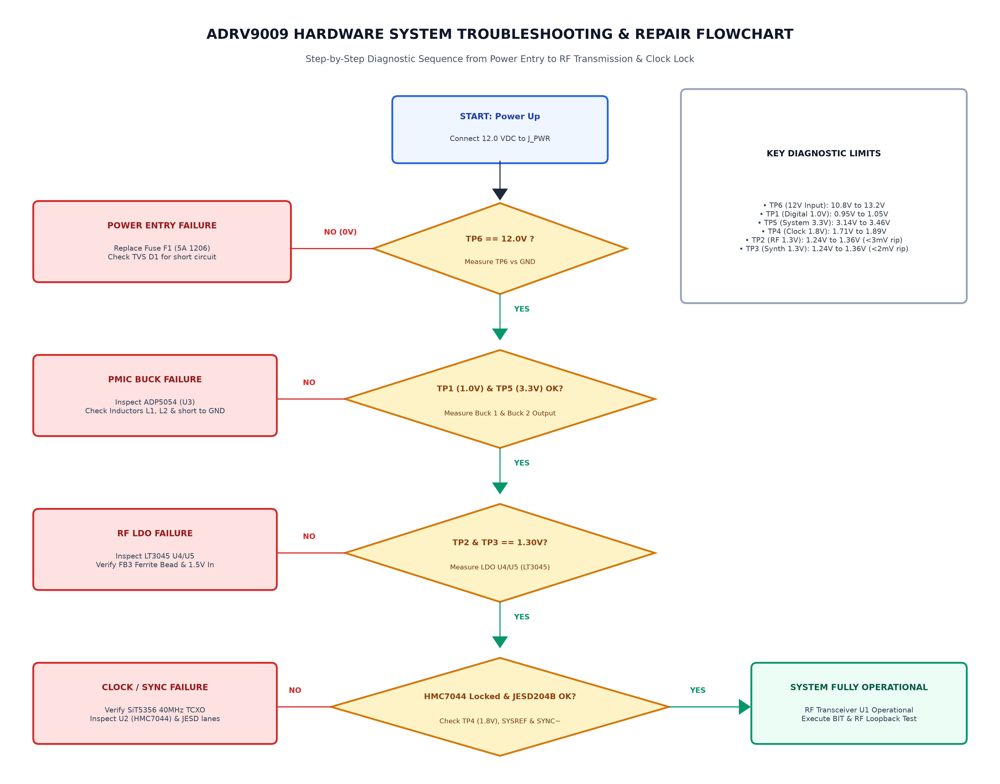
*Figure 1.11: End-to-End ADRV9009 Hardware System Troubleshooting & Fault Isolation Flowchart.*

---

# Part 2: Persian Hardware Maintenance Guide (بخش فارسی)

## ۱. زمان‌بندی نگهداری پیشگیرانه و استانداردهای بازرسی چشمی

| دوره بازرسی | زیرسیستم هدف | اقدام و استاندارد بازرسی | ابزارها و مواد مصرفی |
| :--- | :--- | :--- | :--- |
| **روزانه** | کانکتورهای SMA | بررسی سلامت پین مرکزی و رزوه‌ها؛ سفت‌کردن با گشتاور استاندارد 0.9 N·m. | آچار ترکمتر SMA (5/16 اینچ) |
| **ماهانه** | هیت‌سینک و فن | غبارزدایی پره‌ها؛ کنترل دور فن خنک‌کننده (> 4500 RPM). | دمنده هوای خشک (< 30 psi) |
| **سه ماهه** | خطوط تغذیه DC | اندازه‌گیری ولتاژ نقاط تست TP1-TP6؛ کنترل ریپل به کمتر از 5 mV. | مولتی‌متر دیجیتال، اسیلوسکوپ |
| **شش ماهه** | پد سیلیکونی | بررسی انعطاف‌پذیری پد حرارتی؛ تعویض خمیر سیلیکون فرسوده (PTM7950). | الکل ایزوپروپیل ۹۹.۹٪ (IPA) |
| **سالانه** | اتصالات BGA | بازرسی میکروسکوپی ترک‌های قلع، ویسکرها و تست رطوبت‌زدایی. | میکروسکوپ استریو ۲۰ برابر |

---

## ۲. خروجی Job 1 نرم‌افزار آلتیوم: نقشه‌های شیت‌به‌شیت شماتیک (شیت‌های ۱ تا ۶)

### شکل ۲.۰: نمای کلی خروجی Job1.PDF آلتیوم — مجموعه شیت‌های ۱ تا ۶ شماتیک

*شکل ۲.۰: نمای کلی خروجی Job1.PDF آلتیوم — مجموعه شیت‌های ۱ تا ۶ شماتیک و نقاط تست تشخیصی.*

### شکل ۲.۱: شیت ۱ شماتیک — مدار ورودی ۱۲ ولت، فیوز F1 و دیود TVS D1

*شکل ۲.۱: شیت ۱ شماتیک — مدار ورودی ۱۲ ولت، فیوز ورودی F1 (5A)، دیود هرزگرد TVS D1 و نقطه تست TP6.*

### شکل ۲.۲: شیت ۲ شماتیک — مبدل باک ۴ کاناله ADP5054 (U3) و سلف‌های قدرت

*شکل ۲.۲: شیت ۲ شماتیک — مبدل باک ۴ کاناله ADP5054 (U3)، سلف‌های قدرت L1 تا L4 و نقاط تست TP1 (1.0V) و TP5 (3.3V).*

### شکل ۲.۳: شیت ۳ شماتیک — رگولاتورهای فوق‌کم‌نویز LT3045 (U4, U5)

*شکل ۲.۳: شیت ۳ شماتیک — رگولاتورهای فوق‌کم‌نویز LT3045 (U4, U5)، فیلتر فریت FB3 و نقاط تست TP2 (1.3V RF) و TP3 (1.3V Synth).*

### شکل ۲.۴: شیت ۴ شماتیک — اسیلاتور ۴۰ مگاهرتز TCXO و آی‌سی کلاک HMC7044

*شکل ۲.۴: شیت ۴ شماتیک — اسیلاتور ۴۰ مگاهرتز TCXO (Y1)، آی‌سی توزیع کلاک HMC7044 (U2) و نقاط تست کلاک تفاضلی TP_CLK_P/N.*

### شکل ۲.۵: شیت ۵ شماتیک — تراشه مرکزی ADRV9009 و خطوط JESD204B

*شکل ۲.۵: شیت ۵ شماتیک — تراشه مرکزی ADRV9009 (U1)، خازن‌های کوپلاژ AC خطوط JESD204B و اتصال کانکتور FMC.*

### شکل ۲.۶: شیت ۶ شماتیک — بالون‌های تطبیق امپدانس RF (T1 تا T4)

*شکل ۲.۶: شیت ۶ شماتیک — بالون‌های تطبیق امپدانس RF (T1 تا T4)، دیودهای محافظتی ESD و کانکتورهای SMA.*

---

## ۳. خروجی Job 2 نرم‌افزار آلتیوم: نقشه‌های جانمایی و مونتاژ لایه‌های رو و پشت PCB

### شکل ۲.۷: نمای کلی خروجی Job2.PDF آلتیوم — نقشه‌های مونتاژ لایه‌های رو و پشت

*شکل ۲.۷: نمای کلی خروجی Job2.PDF آلتیوم — نقشه‌های مونتاژ و جانمایی لایه‌های رو و پشت برد.*

### شکل ۲.۸: نقشه عیب‌یابی لایه روی برد (PCB Top Layer)

*شکل ۲.۸: نقشه عیب‌یابی لایه روی برد (PCB Top Layer) شامل موقعیت فیوز F1، دیود TVS، تراشه‌های U1 و U2 و نقاط تست TP1 تا TP6.*

### شکل ۲.۹: نقشه عیب‌یابی لایه پشت برد (PCB Bottom Layer)

*شکل ۲.۹: نقشه عیب‌یابی لایه پشت برد (PCB Bottom Layer) شامل موقعیت آی‌سی ADP5054، رگولاتورهای LT3045 و ماتریس خازن‌های دیکوپلینگ BGA.*

---

## ۴. دستورالعمل ریورک و تعویض تراشه BGA فرستنده/گیرنده ADRV9009

### شکل ۲.۱۰: پروفایل حرارتی استاندارد ۴ مرحله‌ای ریورک BGA

*شکل ۲.۱۰: پروفایل حرارتی استاندارد ۴ مرحله‌ای ریورک و لحیم‌کاری هوای گرم BGA بر اساس استاندارد IPC-7711/7721 با آلیاژ SAC305.*

---

## ۵. فلوچارت جامع عیب‌یابی و تفکیک خطای سخت‌افزاری برد

### شکل ۲.۱۱: فلوچارت گام‌به‌گام عیب‌یابی و تعمیرات سخت‌افزاری

*شکل ۲.۱۱: فلوچارت گام‌به‌گام عیب‌یابی، تست خطوط تغذیه، پایش سلامت کلاک و تفکیک خطاهای سخت‌افزاری برد فرستنده/گیرنده ADRV9009.*
