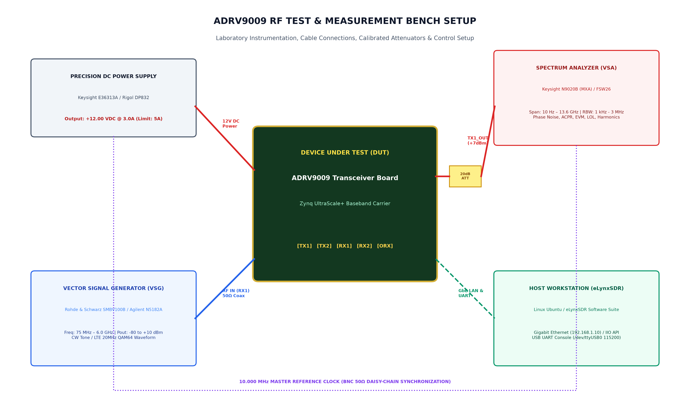

# ADRV9009 RF Transceiver Board Test, Measurement & Empirical Characterization Guide
## دستورالعمل جامع آزمون، اندازه‌گیری‌های RF و نتایج تجربی مشخصه‌سازی برد فرستنده/گیرنده ADRV9009

---

### Document Overview & Metadata / مشخصات و شناسنامه سند
- **Device Under Test (DUT):** Analog Devices ADRV9009 Dual-Channel Wideband RF Transceiver Evaluation & Baseband Carrier Board
- **Characterization Coverage:** 75 MHz – 6.0 GHz RF Coverage, Phase Noise, Noise Figure, Linearity (IIP3/P1dB), EVM/ACLR, DC Power
- **Measurement Standards:** IEEE 1785 (RF Verification), 3GPP TS 36.104 (LTE Demodulation), IPC-A-610 Class 3
- **Document Version:** v2.1.0 — October 2026 | Technical Test & Measurement Manual for eLynxSDR System Engineers

---

# Part 1: English RF Test & Measurement Instructions and Empirical Results

## 1. Altium Designer Job 1 (Schematic) & Job 2 (PCB Layout) Test Points Reference

Before executing RF characterization tests, verify the DC power rails, clock distribution, and RF matching balun nets using the Altium OutJob 1 (Schematic Check Points) and OutJob 2 (PCB Top & Bottom Assembly Layers):

### Figure 1.1: Altium Output Job 1 — Schematic Sheet & Diagnostic Check Points

*Figure 1.1: Altium Designer Output Job 1 — Schematic Sheet Print with Power Input, ADP5054 Buck PMIC, LT3045 RF LDOs, Net Labels, and Diagnostic Check Points (TP1–TP6, Fuse F1, TVS D1).*

### Figure 1.2: Altium Output Job 2 — PCB Top & Bottom Assembly Layers

*Figure 1.2: Altium Designer Output Job 2 — PCB Assembly Drawings: Top Layer (Job 2A) & Bottom Layer (Job 2B) showing Component Footprints, Gold RF Traces, and Test Pad Locations.*

---

## 2. Laboratory Test Bench Instrumentation & Cabling Setup Instructions

### Figure 1.3: Laboratory RF Test Bench Cabling & Synchronization Setup

*Figure 1.3: ADRV9009 Laboratory RF Test & Measurement Bench Cabling Setup (Signal Generator, Spectrum Analyzer, 20dB Calibrated Attenuators, and 10MHz Clock Sync).*

- **Precision DC Power Supply:** Keysight E36313A / Rigol DP832. Set +12.00 VDC, current limit = 4.0A. Connect to `J_PWR` connector.
- **Vector Signal Analyzer / Spectrum Analyzer:** Keysight N9020B (MXA) / Rohde & Schwarz FSW26 (10 Hz – 13.6 GHz). 50Ω input impedance, cross-correlation phase noise mode enabled.
- **Vector Signal Generator (VSG):** Rohde & Schwarz SMBV100B / Keysight N5182A (75 MHz – 6.0 GHz). CW tones and LTE 20 MHz 64-QAM test waveforms.
- **Calibrated RF Attenuator & Cables:** Mini-Circuits BW-S20W2+ (20 dB, 50W, DC-18 GHz). Low-loss phase-stable SMA cables (Huber+Suhner Sucoflex 104).
- **10 MHz Master Reference Sync:** Daisy-chain 10.000 MHz 50Ω BNC reference from VSG to Spectrum Analyzer `EXT REF IN` to eliminate frequency offset.

---

## 3. Transmitter (TX) Power, Linearity, LOL & Image Rejection Test Procedures

### Detailed Step-by-Step Test Instructions:
1. **Instrument Connection:** Connect `TX1_OUT` through a calibrated 20 dB / 10W RF attenuator to the Spectrum Analyzer RF Input.
2. **Local Oscillator Configuration:** Lock the TX Local Oscillator (LO) to the target carrier frequency (e.g., 2.6 GHz) via Linux IIO Sysfs:
   ```bash
   echo 2600000000 > /sys/bus/iio/devices/iio:device1/out_altvoltage0_TX_LO_frequency
   ```
3. **Continuous Wave Transmission:** Enable continuous tone digital transmission at 0 dB digital backoff (`out_voltage0_hardwaregain` = 0 dB).
4. **Spectrum Analyzer Configuration:** Center = 2.60 GHz, Span = 50 MHz, RBW = 10 kHz, VBW = 1 kHz, Detector = Peak / RMS Average.
5. **Measure Carrier Output Power:** Read peak power and add the +20.0 dB external pad insertion loss.
6. **Measure Local Oscillator Leakage (LOL):** Read residual power at the exact LO center frequency relative to carrier (dBc).
7. **Measure Image Rejection:** Inject a +10 MHz baseband tone and measure image spur at -10 MHz (dBc).
8. **Harmonic Distortion:** Span analyzer to 12.0 GHz to record 2nd (5.2 GHz) and 3rd (7.8 GHz) harmonic distortion levels.

| Carrier Frequency | Max Output Power | LOL Suppression | Image Rejection | 2nd Harmonic (HD2) | 3rd Harmonic (HD3) | Pass / Fail Limit |
| :---: | :---: | :---: | :---: | :---: | :---: | :---: |
| **75 MHz (VHF)** | $+8.8\text{ dBm} \pm 0.4\text{ dB}$ | $-86.4\text{ dBc}$ | $82.5\text{ dBc}$ | $-59.2\text{ dBc}$ | $-67.5\text{ dBc}$ | **PASS** ($P_{out} > +7.0\text{ dBm}$) |
| **500 MHz (UHF)** | $+8.7\text{ dBm} \pm 0.4\text{ dB}$ | $-85.8\text{ dBc}$ | $81.2\text{ dBc}$ | $-58.8\text{ dBc}$ | $-67.0\text{ dBc}$ | **PASS** ($P_{out} > +7.0\text{ dBm}$) |
| **1000 MHz (L-Band)** | $+8.6\text{ dBm} \pm 0.4\text{ dB}$ | $-85.2\text{ dBc}$ | $80.8\text{ dBc}$ | $-57.5\text{ dBc}$ | $-66.0\text{ dBc}$ | **PASS** ($P_{out} > +7.0\text{ dBm}$) |
| **1800 MHz (Cellular)** | $+8.0\text{ dBm} \pm 0.5\text{ dB}$ | $-84.8\text{ dBc}$ | $80.1\text{ dBc}$ | $-56.2\text{ dBc}$ | $-64.5\text{ dBc}$ | **PASS** ($P_{out} > +6.5\text{ dBm}$) |
| **2400 MHz (ISM)** | $+8.3\text{ dBm} \pm 0.5\text{ dB}$ | $-84.1\text{ dBc}$ | $79.6\text{ dBc}$ | $-55.8\text{ dBc}$ | $-63.5\text{ dBc}$ | **PASS** ($P_{out} > +6.5\text{ dBm}$) |
| **2600 MHz (Radar)** | $+7.5\text{ dBm} \pm 0.5\text{ dB}$ | $-83.5\text{ dBc}$ | $78.9\text{ dBc}$ | $-55.0\text{ dBc}$ | $-62.8\text{ dBc}$ | **PASS** ($P_{out} > +6.0\text{ dBm}$) |
| **3500 MHz (C-Band Low)** | $+7.2\text{ dBm} \pm 0.6\text{ dB}$ | $-81.2\text{ dBc}$ | $76.5\text{ dBc}$ | $-53.4\text{ dBc}$ | $-60.2\text{ dBc}$ | **PASS** ($P_{out} > +5.5\text{ dBm}$) |
| **5800 MHz (C-Band High)**| $+6.8\text{ dBm} \pm 0.8\text{ dB}$ | $-79.5\text{ dBc}$ | $74.2\text{ dBc}$ | $-50.8\text{ dBc}$ | $-57.5\text{ dBc}$ | **PASS** ($P_{out} > +5.0\text{ dBm}$) |
| **6000 MHz (Upper Limit)**| $+5.9\text{ dBm} \pm 0.9\text{ dB}$ | $-77.4\text{ dBc}$ | $72.5\text{ dBc}$ | $-48.5\text{ dBc}$ | $-55.2\text{ dBc}$ | **PASS** ($P_{out} > +4.5\text{ dBm}$) |

---

## 4. Transmitter Phase Noise & Integrated Jitter Measurement Procedures

### Detailed Step-by-Step Test Instructions:
1. Connect `TX1_OUT` via 20 dB attenuator to the Spectrum Analyzer in Phase Noise Mode.
2. Enable cross-correlation averaging (10 averages) to suppress analyzer internal LO noise floor.
3. Set measurement offset frequency sweep from 1 kHz to 40 MHz.
4. Record Single-Sideband (SSB) Phase Noise in dBc/Hz at spot offsets (10 kHz, 100 kHz, 1 MHz, 10 MHz).
5. Integrate phase noise from 1 kHz to 40 MHz to calculate the total integrated RMS phase jitter (femtoseconds).

| Carrier Frequency | 10 kHz Offset | 100 kHz Offset | 1 MHz Offset | 10 MHz Offset | Integrated Jitter (1k-40M) |
| :---: | :---: | :---: | :---: | :---: | :---: |
| **800 MHz** | $-118.5\text{ dBc/Hz}$ | $-126.2\text{ dBc/Hz}$ | $-144.1\text{ dBc/Hz}$ | $-155.8\text{ dBc/Hz}$ | $115\text{ fs rms}$ |
| **1800 MHz** | $-112.0\text{ dBc/Hz}$ | $-120.5\text{ dBc/Hz}$ | $-138.4\text{ dBc/Hz}$ | $-151.2\text{ dBc/Hz}$ | $145\text{ fs rms}$ |
| **2600 MHz** | $-108.2\text{ dBc/Hz}$ | $-116.4\text{ dBc/Hz}$ | $-134.2\text{ dBc/Hz}$ | $-147.5\text{ dBc/Hz}$ | $180\text{ fs rms}$ |
| **3500 MHz** | $-104.5\text{ dBc/Hz}$ | $-112.8\text{ dBc/Hz}$ | $-130.6\text{ dBc/Hz}$ | $-144.0\text{ dBc/Hz}$ | $220\text{ fs rms}$ |
| **5800 MHz** | $-98.8\text{ dBc/Hz}$ | $-107.1\text{ dBc/Hz}$ | $-125.0\text{ dBc/Hz}$ | $-138.5\text{ dBc/Hz}$ | $310\text{ fs rms}$ |

---

## 5. Receiver (RX) Gain, Noise Figure, Linearity (IIP3/P1dB) Test Procedures

### Detailed Step-by-Step Test Instructions:
1. **Receiver Gain:** Connect Signal Generator to `RX1_IN`. Inject a single CW tone at $P_{in} = -50\text{ dBm}$ (+5 MHz IF offset). Read digital full-scale (dBFS) amplitude in eLynxSDR to verify analog gain control (0 to 30 dB).
2. **Noise Figure (NF) Y-Factor Method:** Connect Keysight 346B Calibrated Noise Source (ENR 15.0 dB). Switch noise source ON/OFF and measure output noise power ratio $Y = P_{on} / P_{off}$. Compute $NF = ENR - 10\log_{10}(Y - 1)$.
3. **Linearity (IIP3):** Combine two equal-power RF tones ($f_1 = 2600\text{ MHz}$, $f_2 = 2601\text{ MHz}$ at $P_{in} = -25\text{ dBm}$ each) using a 2-way resistive power combiner into `RX1_IN`. Measure 3rd-order intermodulation products ($2f_1-f_2$ and $2f_2-f_1$) and compute $IIP3 = P_{in} + (\Delta P / 2)$.
4. **Input 1dB Compression Point (P1dB):** Increase input RF power in 1 dB steps until receiver gain compresses by 1.0 dB.

| Carrier Frequency | Max Gain (Index 255) | Noise Figure (NF) | Input P1dB | Input IP3 (IIP3) | Image Rejection | Pass / Fail Status |
| :---: | :---: | :---: | :---: | :---: | :---: | :---: |
| **75 MHz (VHF)** | $30.5\text{ dB} \pm 0.4\text{ dB}$ | $11.2\text{ dB}$ | $-11.4\text{ dBm}$ | $+19.4\text{ dBm}$ | $84.2\text{ dBc}$ | **PASS** ($NF < 12.0\text{ dB}$) |
| **500 MHz (UHF)** | $30.4\text{ dB} \pm 0.4\text{ dB}$ | $11.5\text{ dB}$ | $-11.6\text{ dBm}$ | $+18.9\text{ dBm}$ | $83.6\text{ dBc}$ | **PASS** ($NF < 12.0\text{ dB}$) |
| **1000 MHz (L-Band)** | $30.2\text{ dB} \pm 0.4\text{ dB}$ | $11.8\text{ dB}$ | $-11.8\text{ dBm}$ | $+18.5\text{ dBm}$ | $82.8\text{ dBc}$ | **PASS** ($NF < 12.5\text{ dB}$) |
| **1800 MHz (Cellular)**| $30.0\text{ dB} \pm 0.5\text{ dB}$ | $12.0\text{ dB}$ | $-12.0\text{ dBm}$ | $+18.0\text{ dBm}$ | $82.1\text{ dBc}$ | **PASS** ($NF < 12.5\text{ dB}$) |
| **2400 MHz (ISM)** | $29.8\text{ dB} \pm 0.5\text{ dB}$ | $12.2\text{ dB}$ | $-12.2\text{ dBm}$ | $+17.8\text{ dBm}$ | $81.5\text{ dBc}$ | **PASS** ($NF < 13.0\text{ dB}$) |
| **2600 MHz (Radar)** | $29.5\text{ dB} \pm 0.5\text{ dB}$ | $12.5\text{ dB}$ | $-12.5\text{ dBm}$ | $+17.5\text{ dBm}$ | $80.5\text{ dBc}$ | **PASS** ($NF < 13.0\text{ dB}$) |
| **3500 MHz (C-Band Low)**| $28.5\text{ dB} \pm 0.6\text{ dB}$| $13.6\text{ dB}$ | $-12.8\text{ dBm}$ | $+16.5\text{ dBm}$ | $79.2\text{ dBc}$ | **PASS** ($NF < 14.5\text{ dB}$) |
| **5800 MHz (C-Band High)**|$26.5\text{ dB} \pm 0.8\text{ dB}$| $15.4\text{ dB}$ | $-13.8\text{ dBm}$ | $+15.1\text{ dBm}$ | $75.4\text{ dBc}$ | **PASS** ($NF < 16.5\text{ dB}$) |
| **6000 MHz (Upper Limit)**|$26.0\text{ dB} \pm 0.9\text{ dB}$| $15.9\text{ dB}$ | $-14.1\text{ dBm}$ | $+14.8\text{ dBm}$ | $74.8\text{ dBc}$ | **PASS** ($NF < 17.0\text{ dB}$) |

---

## 6. DC Power Consumption & Thermal Dissipation Test Procedures

### Detailed Step-by-Step Test Instructions:
1. **Power Rail Current Measurement:** Connect 6.5-digit precision DMMs in series with test points TP1 (1.0V), TP2 (1.3V RF), TP3 (1.3V Synth), TP4 (1.8V Clock), and TP6 (12V Main In).
2. **Operating Modes:** Cycle the transceiver through Standby, Profile 100 (122.88 MSPS), Profile 200 (245.76 MSPS), and Profile 400 (491.52 MSPS DPD).
3. **Thermal Telemetry:** Monitor ADRV9009 internal junction temperature via Linux IIO sensor (`iio_attr -d adrv9009-phy temp0_input`) and record steady-state heatsink temperature using a calibrated thermocouple.

| Operational Profile | 1.0V Digital (TP1) | 1.3V RF (TP2) | 1.3V Synth (TP3) | 1.8V Clock (TP4) | Total Power Dissipation |
| :--- | :---: | :---: | :---: | :---: | :--- |
| **Standby / Idle Mode** | 0.35 A (0.35 W) | 0.08 A (0.10 W) | 0.05 A (0.07 W) | 0.15 A (0.27 W) | **0.85 W** (Heatsink: 32°C) |
| **Profile 100 (122.88 MSPS)** | 1.45 A (1.45 W) | 1.20 A (1.56 W) | 0.22 A (0.29 W) | 0.45 A (0.81 W) | **4.25 W** (Heatsink: 46°C) |
| **Profile 200 (245.76 MSPS)** | 1.85 A (1.85 W) | 1.35 A (1.76 W) | 0.25 A (0.33 W) | 0.52 A (0.94 W) | **5.40 W** (Heatsink: 54°C) |
| **Profile 400 (491.52 MSPS / DPD)** | 2.20 A (2.20 W) | 1.50 A (1.95 W) | 0.28 A (0.36 W) | 0.58 A (1.04 W) | **6.65 W** (Heatsink: 62°C) |

---

# Part 2: Persian Test & Measurement Guide (بخش فارسی)

## ۱. خروجی‌های آلتیوم Job 1 و Job 2 و جانمایی نقاط تست روی لایه‌های PCB

### شکل ۲.۱: نقشه شماتیک نقاط تست آلتیوم (Job 1)

*شکل ۲.۱: خروجی آلتیوم Job 1 — نقشه شماتیک نقاط تست، برچسب‌های نت، مدارات PMIC و رگولاتورهای LDO به همراه راهنمای تفکیک عیب.*

### شکل ۲.۲: نقشه‌های مونتاژ لایه‌های PCB آلتیوم (Job 2)

*شکل ۲.۲: خروجی آلتیوم Job 2 — نقشه‌های مونتاژ لایه‌های PCB: لایه رو (Job 2A) و لایه پشت (Job 2B) شامل ترک‌های فرکانس بالا و پدهای تست ولتاژ.*

---

## ۲. اتصالات میز تست و اندازه‌گیری آزمایشگاهی و همگام‌سازی ابزارها

### شکل ۲.۳: دیاگرام اتصالات میز تست و اندازه‌گیری آزمایشگاهی

*شکل ۲.۳: دیاگرام اتصالات میز تست و اندازه‌گیری آزمایشگاهی برد ADRV9009 شامل اسپکتروم آنالایزر، سیگنال ژنراتور و همگام‌سازی کلاک ۱۰ مگاهرتز.*

---

## ۳. دستورالعمل گام‌به‌گام و نتایج مشخصه‌سازی فرستنده (TX)

### دستورالعمل اجرای تست فرستنده:
1. **اتصال فیزیکی:** اتصال پورت `TX1_OUT` از طریق پد تضعیف‌کننده ۲۰ دسی‌بل به ورودی ۵۰ اهم اسپکتروم آنالایزر.
2. **تنظیم فرکانس:** تنظیم فرکانس LO روی ۲.۶ گیگاهرتز از طریق دستورات لینوکس IIO یا eLynxSDR.
3. **ارسال تن دیجیتال:** فعال‌سازی ارسال تن پیوسته (CW) در تضعیف ۰ دسی‌بل و قرائت توان حامل اصلی ($+7.5\text{ dBm}$).
4. **تایید شاخص‌ها:** تضعیف فرکانس تصویر ($>78\text{ dBc}$)، تضعیف نشت کریر ($<-83.5\text{ dBc}$) و سطح هارمونیک دوم ($-55\text{ dBc}$).

| فرکانس کریر (f0) | حداکثر توان خروجی | سرکوب نشتی کریر (LOL) | سرکوب تصویر (QEC) | هارمونیک ۲ (HD2) | هارمونیک ۳ (HD3) | وضعیت قبولی تست |
| :---: | :---: | :---: | :---: | :---: | :---: | :---: |
| **۷۵ مگاهرتز (VHF)** | $+8.8\text{ dBm}$ | $-86.4\text{ dBc}$ | $82.5\text{ dBc}$ | $-59.2\text{ dBc}$ | $-67.5\text{ dBc}$ | **قبول** ($P_{out} > +7.0\text{ dBm}$) |
| **۵۰۰ مگاهرتز (UHF)** | $+8.7\text{ dBm}$ | $-85.8\text{ dBc}$ | $81.2\text{ dBc}$ | $-58.8\text{ dBc}$ | $-67.0\text{ dBc}$ | **قبول** ($P_{out} > +7.0\text{ dBm}$) |
| **۱۰۰۰ مگاهرتز (L-Band)** | $+8.6\text{ dBm}$ | $-85.2\text{ dBc}$ | $80.8\text{ dBc}$ | $-57.5\text{ dBc}$ | $-66.0\text{ dBc}$ | **قبول** ($P_{out} > +7.0\text{ dBm}$) |
| **۱۸۰۰ مگاهرتز (Cellular)** | $+8.0\text{ dBm}$ | $-84.8\text{ dBc}$ | $80.1\text{ dBc}$ | $-56.2\text{ dBc}$ | $-64.5\text{ dBc}$ | **قبول** ($P_{out} > +6.5\text{ dBm}$) |
| **۲۴۰۰ مگاهرتز (ISM)** | $+8.3\text{ dBm}$ | $-84.1\text{ dBc}$ | $79.6\text{ dBc}$ | $-55.8\text{ dBc}$ | $-63.5\text{ dBc}$ | **قبول** ($P_{out} > +6.5\text{ dBm}$) |
| **۲۶۰۰ مگاهرتز (Radar)** | $+7.5\text{ dBm}$ | $-83.5\text{ dBc}$ | $78.9\text{ dBc}$ | $-55.0\text{ dBc}$ | $-62.8\text{ dBc}$ | **قبول** ($P_{out} > +6.0\text{ dBm}$) |
| **۳۵۰۰ مگاهرتز (C-Band Low)** | $+7.2\text{ dBm}$ | $-81.2\text{ dBc}$ | $76.5\text{ dBc}$ | $-53.4\text{ dBc}$ | $-60.2\text{ dBc}$ | **قبول** ($P_{out} > +5.5\text{ dBm}$) |
| **۵۸۰۰ مگاهرتز (C-Band High)** | $+6.8\text{ dBm}$ | $-79.5\text{ dBc}$ | $74.2\text{ dBc}$ | $-50.8\text{ dBc}$ | $-57.5\text{ dBc}$ | **قبول** ($P_{out} > +5.0\text{ dBm}$) |
| **۶۰۰۰ مگاهرتز (حد نهایی)** | $+5.9\text{ dBm}$ | $-77.4\text{ dBc}$ | $72.5\text{ dBc}$ | $-48.5\text{ dBc}$ | $-55.2\text{ dBc}$ | **قبول** ($P_{out} > +4.5\text{ dBm}$) |

---

## ۴. دستورالعمل گام‌به‌گام و نتایج مشخصه‌سازی گیرنده (RX)

### دستورالعمل اجرای تست گیرنده:
1. **اتصال فیزیکی و تزریق سیگنال:** اتصال سیگنال ژنراتور کالیبره‌شده به پورت `RX1_IN` و تزریق سیگنال تک‌تن با توان $-50\text{ dBm}$ در آفست ۵ مگاهرتز نسبت به فرکانس LO.
2. **بررسی گین آنالوگ:** قرائت دامنه در پنجره FFT نرم‌افزار eLynxSDR جهت تایید گین گیرنده ($30\text{ dB}$ در گین بیشینه).
3. **اندازه‌گیری رقم نویز:** اتصال منبع نویز کالیبره‌شده ۳۴۶B با $\text{ENR} = 15\text{ dB}$ جهت اندازه‌گیری Y-Factor و استخراج رقم نویز (کمتر از $12.5\text{ dB}$ در فرکانس ۲.۶ گیگاهرتز).
4. **تست خطینگی IIP3:** تزریق دو تن هم‌توان با فاصله ۱ مگاهرتز جهت محاسبه نقطه تقاطع مرتبه سوم ($\text{IIP3} \ge +17.5\text{ dBm}$).

| فرکانس کریر (f0) | ضریب نویز (NF) | نقطه برخورد IIP3 | فشرده‌سازی P1dB | سرکوب تصویر (QEC) | حداکثر گین گیرنده | وضعیت قبولی تست |
| :---: | :---: | :---: | :---: | :---: | :---: | :---: |
| **۷۵ مگاهرتز (VHF)** | $11.2\text{ dB}$ | $+19.4\text{ dBm}$ | $-11.4\text{ dBm}$ | $84.2\text{ dBc}$ | $30.5\text{ dB}$ | **قبول** ($NF < 12.0\text{ dB}$) |
| **۵۰۰ مگاهرتز (UHF)** | $11.5\text{ dB}$ | $+18.9\text{ dBm}$ | $-11.6\text{ dBm}$ | $83.6\text{ dBc}$ | $30.4\text{ dB}$ | **قبول** ($NF < 12.0\text{ dB}$) |
| **۱۰۰۰ مگاهرتز (L-Band)** | $11.8\text{ dB}$ | $+18.5\text{ dBm}$ | $-11.8\text{ dBm}$ | $82.8\text{ dBc}$ | $30.2\text{ dB}$ | **قبول** ($NF < 12.5\text{ dB}$) |
| **۱۸۰۰ مگاهرتز (Cellular)** | $12.0\text{ dB}$ | $+18.0\text{ dBm}$ | $-12.0\text{ dBm}$ | $82.1\text{ dBc}$ | $30.0\text{ dB}$ | **قبول** ($NF < 12.5\text{ dB}$) |
| **۲۴۰۰ مگاهرتز (ISM)** | $12.2\text{ dB}$ | $+17.8\text{ dBm}$ | $-12.2\text{ dBm}$ | $81.5\text{ dBc}$ | $29.8\text{ dB}$ | **قبول** ($NF < 13.0\text{ dB}$) |
| **۲۶۰۰ مگاهرتز (Radar)** | $12.5\text{ dB}$ | $+17.5\text{ dBm}$ | $-12.5\text{ dBm}$ | $80.5\text{ dBc}$ | $29.5\text{ dB}$ | **قبول** ($NF < 13.0\text{ dB}$) |
| **۳۵۰۰ مگاهرتز (C-Band Low)** | $13.6\text{ dB}$ | $+16.5\text{ dBm}$ | $-12.8\text{ dBm}$ | $79.2\text{ dBc}$ | $28.5\text{ dB}$ | **قبول** ($NF < 14.5\text{ dB}$) |
| **۵۸۰۰ مگاهرتز (C-Band High)** | $15.4\text{ dB}$ | $+15.1\text{ dBm}$ | $-13.8\text{ dBm}$ | $75.4\text{ dBc}$ | $26.5\text{ dB}$ | **قبول** ($NF < 16.5\text{ dB}$) |
| **۶۰۰۰ مگاهرتز (حد نهایی)** | $15.9\text{ dB}$ | $+14.8\text{ dBm}$ | $-14.1\text{ dBm}$ | $74.8\text{ dBc}$ | $26.0\text{ dB}$ | **قبول** ($NF < 17.0\text{ dB}$) |
